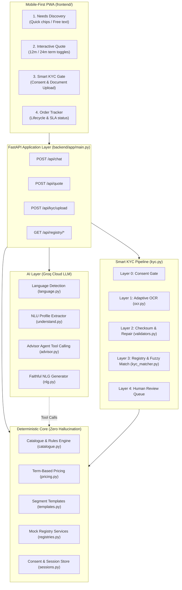

# Project Udyam Digital

> **Intelligent SMB Telecom & Digital Services Onboarding Platform**  
> *Developed for Airtel Accel Business · YTL Hackathon (Track A)*

---

## 1. Executive Summary

Indian Micro, Small, and Medium Enterprises (MSMEs) represent over 63 million businesses but face steep barriers when adopting enterprise digital infrastructure: complex product catalogues, manual paperwork, high upfront installation costs, and multi-day KYC verification delays.

**Project Udyam Digital** transforms this experience into a self-service, phone-first journey that completes onboarding in one sitting:

**Multilingual Advisor -> Dynamic Term Quote -> Smart KYC Pipeline -> Order Tracker**

### Core Design Philosophy
- **Deterministic Core, AI at the Edge:** Generative AI (powered by Groq) assists the owner through conversational inquiry, translation, and profile understanding. However, **rule decisions are deterministic and tested**.
- **Privacy by Construction:** Purpose-bound consent gates, identifier masking (`mask_id`), and designed around the DPDP Act 2023.
- **Language Agnostic:** Automatic script detection and localized translation with strict numerical faithfulness safeguards.

---

## 2. System Architecture



---

## 3. Subsystem Breakdown

### A. Conversational Advisor & NLU
- **Groq Tool Calling:** Uses `openai/gpt-oss-120b` (or `llama-3.3-70b-versatile`) with 4 deterministic tools:
  - `detect_and_recommend_template`
  - `get_eligible_products`
  - `check_gstin`
  - `propose_and_quote_bundle`
- **Language-Agnostic Architecture (ADR-009):**
  - **Layer A:** Instant Unicode script analysis (Latin, Devanagari, Tamil, Telugu, Bengali, Gujarati, Kannada, Malayalam).
  - **Layer B:** Fast LLM disambiguation (`openai/gpt-oss-20b`) for shared scripts (e.g. Marathi vs Hindi in Devanagari, English vs Hinglish in Latin).
  - **Faithfulness Rail:** Strict regex/digit checks ensure translated replies cannot hallucinate or misquote numbers or pricing.
  - **SQLite i18n Cache:** "Translate once, cache forever" reduces latency and LLM token usage.

### B. Catalogue Rules & Pricing Engine
- **Catalogue:** 25 enterprise products across Broadband, Leased Lines, Business Postpaid, SD-WAN, Cloud CCTV, IoT, and Security.
- **Rule Verification:** Evaluates city tier restrictions, minimum employee counts, multi-site thresholds, GSTIN dependencies, and prerequisite products (e.g., CCTV requires active internet).
- **Term-Based Pricing (ADR-005):**
  - **12-Month Term:** Priced 40% between maximum catalogue price and floor.
  - **24-Month Term:** Priced 80% to floor (giving customer up to ~9% monthly savings while preserving 20% margin headroom).
  - **Setup Fees:** Calculated per unit, fully aligned with historical sales audits.

### C. Smart 4-Layer KYC Verification (ADR-010)
- **Layer 0 (Consent Gate):** Requires explicit consent before processing any business document.
- **Layer 1 (Adaptive OCR):** Image preprocessing with Gaussian adaptive thresholding to suppress diagonal watermarks on GST certificates; word-level confidence scoring via Tesseract.
- **Layer 2 (Checksum & Confusable Repair):** Validates Mod-36 checksum. If OCR confused monospace characters (0↔O, 8↔B, 5↔S, 2↔Z), attempts up to 2 swaps to reach a valid checksum.
- **Layer 3 (Registry Cross-Check & Fuzzy Match):** Cross-checks candidates against mock registries. Blocks cancelled/suspended GSTINs. Evaluates name matching using token-set Jaccard and sequence matching ($\ge 80\%$ auto-approved).
- **Layer 4 (Human Review Queue):** Low confidence (<60%), ambiguous name match (60–79%), or missing data routes automatically to an in-memory review queue (`/api/kyc/review`).

---

## 4. Repository Structure

```text
udyam-digital/
├── .env.example               # Template environment configuration
├── .env                       # Local secrets (paste GROQ_API_KEY here)
├── requirements.txt           # Python dependencies (FastAPI, Groq, Pillow, pytesseract)
├── README.md                  # System overview and architecture guide
│
├── backend/
│   ├── app/
│   │   ├── advisor.py         # Groq tool-calling agent loop & context
│   │   ├── catalogue.py       # Product models & dependency validation
│   │   ├── config.py          # Settings & environment variables
│   │   ├── i18n.py            # SQLite localization cache & translator
│   │   ├── kyc.py             # 4-layer KYC orchestrator & review queue
│   │   ├── kyc_matcher.py     # Fuzzy name and address similarity matcher
│   │   ├── language.py        # 2-layer script & language detection
│   │   ├── llm.py             # Unified Groq and mock LLM interfaces
│   │   ├── main.py            # FastAPI endpoints & static frontend mount
│   │   ├── nlg.py             # Natural language generation & faithfulness rails
│   │   ├── ocr.py             # Image preprocessing, Tesseract OCR & parsing
│   │   ├── pricing.py         # Term-based pricing & quote generator
│   │   ├── registries.py      # GSTIN & Udyam mock registry lookups
│   │   ├── sessions.py        # Consent gating & privacy-preserving store
│   │   ├── templates.py       # 4 SMB segment bundles & quick chips
│   │   ├── understand.py      # Business profile draft extraction
│   │   └── validators.py      # GSTIN Mod-36 checksum, OCR repair, privacy mask
│   └── tests/
│       ├── test_advisor.py    # Advisor agent & tool execution tests (7)
│       ├── test_api.py        # End-to-end FastAPI endpoint tests (12)
│       ├── test_catalogue.py  # Catalogue rules & validation tests (7)
│       ├── test_i18n.py       # SQLite cache & translation tests (4)
│       ├── test_kyc.py        # 4-layer KYC pipeline tests (11)
│       ├── test_kyc_matcher.py# Fuzzy matching & threshold tests (25)
│       ├── test_language.py   # Script & language detection tests (3)
│       ├── test_nlg.py        # Numerical faithfulness rail tests (3)
│       ├── test_ocr.py        # OCR parsing & graceful fallback tests (12)
│       ├── test_pricing.py    # Term pricing & add-on tests (9)
│       ├── test_registries.py # Registry lookups & repair tests (6)
│       ├── test_templates.py  # Bundle generation tests (7)
│       ├── test_understand.py # Profile extraction tests (2)
│       └── test_validators.py # Checksum, repair & mask tests (7)
│
├── data/
│   ├── mock_gstin_registry.csv# 3,534 GSTIN records (Active, Cancelled, Suspended)
│   ├── mock_udyam_registry.csv# 2,723 MSME registration records
│   ├── product_catalogue.csv  # 25 Airtel enterprise products & rules
│   ├── smb_leads.csv          # 5,000 historical sales lead records
│   └── kyc_documents/         # Synthetic sample certificates for testing
│
├── frontend/
│   ├── index.html             # Mobile-first self-service PWA interface
│   └── template.html          # HTML template with build placeholders
│
├── locales/
│   └── en.json                # Canonical UI strings (50+ translation keys)
│
├── docs/
│   ├── architecture.mmd       # Mermaid architecture diagram source
│   └── DECISIONS.md           # Architecture Decision Records (ADR-001 to ADR-010)
│
└── scripts/
    ├── data_audit.py          # Dataset consistency audit
    ├── pricing_backtest.py    # Revenue-neutrality backtesting against historical sales
    ├── lang_eval.py           # Multi-language regional benchmark (18 scenarios)
    ├── generate_synthetic_docs.py # Synthetic KYC certificate generator
    └── ocr_probe.py           # OCR baseline evaluation script
```

---

## 5. API Reference

| Method | Endpoint | Description |
|---|---|---|
| `GET` | `/api/health` | Service health status and catalog inventory |
| `GET` | `/api/catalogue` | Returns all 25 products with metadata and rules |
| `GET` | `/api/templates` | Returns segment bundle templates (Micro, Prof, Multi, Mfg) |
| `POST` | `/api/chat` | Turn-based conversation with Groq advisor agent |
| `POST` | `/api/quote` | Calculates quote, term savings, and valid add-ons |
| `POST` | `/api/quote/toggle-addon` | Safely toggles an add-on product with rule checks |
| `GET` | `/api/registry/gstin/{gstin}` | Registry lookup with automatic OCR confusable repair |
| `GET` | `/api/registry/udyam/{udyam}` | Registry lookup for MSME Udyam registration |
| `POST` | `/api/consent` | Records privacy consent gate prior to document intake |
| `POST` | `/api/kyc/upload` | Uploads document (image/PDF), runs 4-layer verification |
| `GET` | `/api/kyc/status/{session_id}` | Retrieves latest verification outcome and audit trail |
| `GET` | `/api/kyc/review` | Lists pending items in human review triage queue |
| `POST` | `/api/kyc/review/{item_id}` | Manually approves or rejects flagged KYC submission |
| `GET` | `/api/i18n/{language}` | Returns localized UI strings (cached in SQLite) |

---

## 6. Quickstart Guide

### Prerequisites
1. **Python 3.11+** installed.
2. **Tesseract OCR** installed:
   - *Windows:* Download from [UB-Mannheim/tesseract](https://github.com/UB-Mannheim/tesseract/wiki) (ensure added to PATH).
   - Verify in terminal: `tesseract --version`.

### Installation
```bash
# 1. Install dependencies
pip install -r requirements.txt

# 2. Configure environment (optional, mock mode is active by default)
# Copy template and add your API key:
cp .env.example .env
```

### Running the Application
```bash
# Start the FastAPI server (serves API and mounted frontend UI)
uvicorn backend.app.main:app --reload --port 8000
```
Open **`http://localhost:8000`** in any mobile or desktop browser.

### Running Verification & Tests
```bash
# Run the complete test suite (135 unit & integration tests)
pytest backend/tests -v

# Generate synthetic test documents (clean, watermarked, cancelled)
python scripts/generate_synthetic_docs.py

# Run regional language evaluation benchmark (Hindi, Marathi, Tamil, Bengali)
python scripts/lang_eval.py
```

---

## 7. Architecture Decision Records (ADRs) & Compliance

Key architectural choices and compliance specifications are documented in:
- [`docs/DECISIONS.md`](docs/DECISIONS.md) - Architecture Decision Records (ADR-001 through ADR-012)
- [`docs/PRIVACY_NOTE.md`](docs/PRIVACY_NOTE.md) - Data Privacy & Security Note (DPDP Act 2023)
- [`docs/METRICS.md`](docs/METRICS.md) - Benchmark metrics, backtest results, and evaluation data

---

## 8. License & Attribution

Developed as a demonstration study for the **YTL Hackathon (Track A)**. All customer records, registry entries, and document specimens are synthetic.
